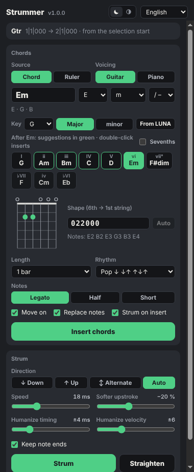
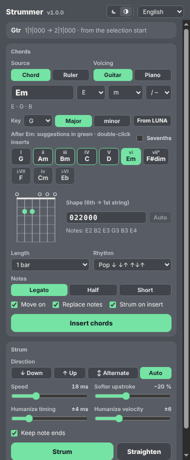

# Strummer for LUNA

Write chords into a MIDI track and strum them like a guitarist. Type a chord, pick a guitar
shape or use LUNA's Chord ruler; choose a rhythm; get suggestions for what comes next in the
song's key; and turn block chords into real strums: strings a few milliseconds apart, down or
up, softer upstrokes, a little human.

  
  

## Features

- **Chords from a name, a shape or the Chord ruler.** Type any chord (`Am7`, `F#m7b5`, `D/F#`,
  `Cadd9`…) or pick root, type and bass from the menus; or write the chords already on LUNA's
  Chord ruler within the range.
- **Guitar voicings** as a guitarist plays them: open chords first, then E- and A-shape barre
  chords. A chord diagram shows the shape; edit it by typing frets (`x32010`) or clicking the
  diagram.
- **Piano voicings** in the octave you choose, with an optional bass note an octave below, and
  smooth voice leading from chord to chord.
- **Key and suggestions.** Set the song's key (or read it from the session's key signature) and
  see every chord in the key with its degree (I, ii, iii…), plus borrowed chords. The chords that
  usually come next are outlined. Click to pick, double-click to insert.
- **Sevenths** for every chord in the key with one switch.
- **Rhythm patterns:** sustained, one hit per bar, half notes, quarter notes, eighths ↓↑, pop,
  ballad, rock, offbeat (reggae) and sixteenths.
- **Chord length** (whole range, 1 beat, ½ bar, 1, 2 or 4 bars) and **note length** (legato,
  half, short). With *Move on*, the selection steps forward after each insert, so a progression
  is written chord by chord, all in one clip.
- **Strum what is already there:** the selected notes, or the notes in the range. Speed (0–60 ms
  between strings), direction (down, up, alternate, or auto: down on the beat, up on the
  off-beat), softer upstrokes, and humanized timing and velocity. Strumming again replaces the
  previous strum; **Straighten** lines the notes up again.
- **Undo** anything with Cmd+Z in LUNA.
- **Dark and grey themes.**
- **7 languages:** English, Español, Català, Français, Deutsch, Italiano and Português.

## How to use it

1. In LUNA, select an instrument track and, if you like, a range.
2. In **Strummer**, type or pick a chord (or choose **Ruler** to use the Chord ruler), choose
   Guitar or Piano, a length and a rhythm.
3. Press **Insert chords**. With a fixed length and *Move on*, keep double-clicking the
   suggested chords to write the progression.
4. To strum chords that are already there, select them (or a range) and press **Strum**.

If the range touches a MIDI clip without covering all of it, Strummer asks you to select inside
the clip or in an empty gap.

## Support

If something does not work as expected, Alt-click the version number at the top of the window:
it copies a short report to paste in a message to fedetrillo@gmail.com.

## Install

Requires LUNA 3.1.2 or later. Install it from LUNA's Add On marketplace, or download
`strummer.lunaaddon` from the latest release and double-click it. Then open a session and
choose **Add Ons > Windows > Strummer**.

## En español

Escribe acordes en una pista MIDI y rasguéalos como un guitarrista. Escribe un acorde, elige
una posición de guitarra o usa la regla de acordes de LUNA; elige un ritmo; deja que te sugiera
qué acorde viene después según el tono de la canción; y convierte acordes en bloque en rasgueos
reales: cuerdas separadas unos milisegundos, hacia abajo o hacia arriba, el golpe hacia arriba
más suave y un toque humano. Voicings de guitarra y piano, duración del acorde y de las notas,
modo oscuro y gris, y 7 idiomas.

## Licence

Copyright (c) 2026 Fede Trillo. All rights reserved. Free to install and use in LUNA; the code
may not be copied, modified or redistributed. See [LICENSE](LICENSE). The bundled LUNA Builder
SDK is Universal Audio's, under the Apache License 2.0: see
[THIRD_PARTY_NOTICES.md](THIRD_PARTY_NOTICES.md).

Contact: fedetrillo@gmail.com
